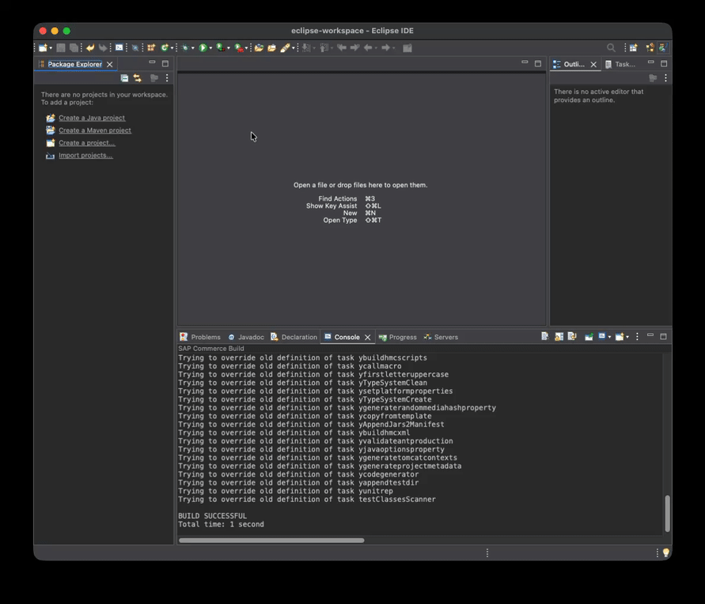
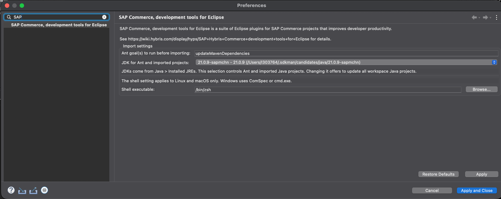

# SAP Commerce Project Importer

Project Importer functionality aims to import SAP Commerce platform with extensions as Eclipse projects and solve dependency rules based on `project.xml` file.

## Features

Importer contains set of features and options available for developers. Most of them have been listed below.

### Project Import Wizard

Plugin provides new option available in IDE standard Import wizard option. Option is available in menu: `File -> Import...`.
There you can find category `SAP` and there `Import SAP Platform`.

Next wizard step shows list of checkboxes available during import and available directory field. It is required to point valid `hybris/bin/platform` folder for your project.

### Custom JDK Selection

It is possible to select proper JDK version for project import, which is required for running build process for SAP Commerce projects. Proper selection of JDK can be done via: `Window -> Settings -> Preferences -> SAP Commerce -> Import settings`.

By default, the plugin uses JDK used by IDE. In order to pin specific JDK version for Ant build process, you can change it in plugin preference page. Same JDK will be used for setting SAP Commerce extension project settings.

For more info about custom JDK selection see [Custom JDK Selection](../import-jdk.md).
